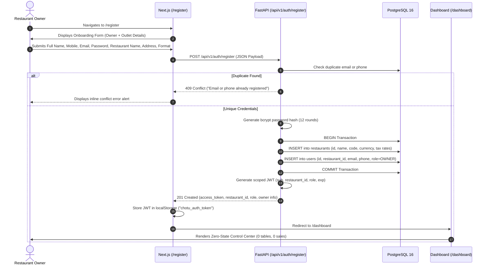

# FRESH RESTAURANT ONBOARDING REPORT
**Project:** Chotu Restro AI  
**Module:** Restaurant Self-Serve Onboarding & Account Provisioning  
**Author:** Principal Software Architect & DevOps Lead  
**Date:** November 25, 2026  
**Status:** IMPLEMENTED, TESTED & PRODUCTION READY

---

## 1. ONBOARDING ARCHITECTURE & WORKFLOW

Chotu Restro AI provides an automated, self-serve onboarding flow for restaurant restaurateurs, cafe founders, cloud kitchen operators, and enterprise franchisees. The process requires zero manual developer intervention, zero seed injection, and creates a tenant-isolated environment.



---

## 2. DATA CAPTURED DURING ONBOARDING

The registration interface (`src/app/(auth)/register/page.tsx`) collects both identity credentials and statutory restaurant operational details:

### 2.1 Owner Account Details
- **Full Legal Name:** (e.g., `Sumit Kumar`)
- **Primary Mobile Number:** Indian 10-digit mobile number normalized to standard format (e.g., `9876543210` -> `+91 9876543210`).
- **Owner Email Address:** Valid email utilized for billing receipts, audit reports, and password recovery.
- **Secure Password:** Minimum 8 characters; salted and hashed via `bcrypt` with work factor 12.

### 2.2 Restaurant Business Profile
- **Restaurant Name:** Brand name displayed on guest QR menus, printed KOTs, and tax invoices (e.g., `Copper Chimney Bistro`).
- **Outlet Format:** Operational classification (`dinein` Dine-In Dining, `qsr` Counter QSR, `cafe` Café & Bakery, `cloud` Cloud Kitchen).
- **Physical Address & City:** Full address, city, state, pincode, country (defaults to India).
- **Operating Hours:** Default standard service window (`11:00 AM - 11:00 PM`).

### 2.3 Statutory Tax & Financial Details (Optional at Setup)
- **GSTIN:** 15-character Indian Goods and Services Tax Identification Number.
- **FSSAI License:** 14-digit Food Safety and Standards Authority of India registration.
- **UPI VPA:** Virtual Payment Address for dynamic QR table billing (e.g., `copperchimney@icici`).

---

## 3. DATABASE RECORDS CREATED

Upon submission, the backend executes an atomic transaction creating the following records:

### 3.1 `restaurants` Table
```sql
INSERT INTO restaurants (
    id, name, code, address, city, state, country, pincode, phone,
    currency, cgst_percent, sgst_percent, service_charge_percent,
    gstin, fssai_number, business_hours, upi_vpa, invoice_prefix, created_at
) VALUES (
    'rest-a1b2c3d4', 'Copper Chimney Bistro', 'COPPER-CHIM',
    'Plot 42, Hiranandani Estate', 'Thane', 'Maharashtra', 'India', '400607',
    '+91 9876543210', 'INR', 2.50, 2.50, 5.00,
    '27AAAAA0000A1Z5', '11521001000999', '11:00 AM - 11:00 PM',
    'copperchimney@icici', 'INV', NOW()
);
```

### 3.2 `users` Table
```sql
INSERT INTO users (
    id, restaurant_id, email, phone, full_name, hashed_password,
    role, is_active, created_at
) VALUES (
    'user-e5f6g7h8', 'rest-a1b2c3d4', 'sumit@copperchimney.in', '+91 9876543210',
    'Sumit Kumar', '$2b$12$...', 'owner', TRUE, NOW()
);
```

---

## 4. DASHBOARD ZERO-STATE EXPERIENCE

When a newly registered owner enters `/dashboard`, the interface avoids showing hardcoded dummy metrics or breaking with division-by-zero errors. Instead, it provides actionable, guided empty states:

| Module | Zero-State Visual Presentation | Guided Next Action |
| :--- | :--- | :--- |
| **KPI: Net Revenue** | `₹0.00` ("Tax & service charge inclusive") | POS orders automatically populate revenue |
| **KPI: Occupancy** | `0 / 0 Tables` ("0 tables configured • 0% Capacity") | Link to Floor Map: "Configure Tables" |
| **KPI: Orders Completed** | `0` ("0 completed orders today") | Link to POS Terminal: "Create First Order" |
| **KPI: Kitchen KOTs** | `0 Tickets` ("All kitchen stations clear") | Tickets appear when orders are fired |
| **Floor Status Grid** | Dotted border container: *"No dining tables configured yet."* | Prominent CTA: `[Configure Tables & Floor Plan →]` |
| **Top Performers** | Clean container: *"No orders processed today. Sales velocity will show here."* | Factual ordering velocity displays as orders settle |
| **Inventory Alerts** | Green status: *"All inventory items are currently above safety thresholds."* | Link to Inventory: `[Open Inventory Ledger]` |
| **Header Identity** | Displays newly registered restaurant name (e.g. `Copper Chimney Bistro`) | Dynamic sync from `AuthContext` |

---

## 5. TRANSITION FROM REGISTRATION TO ACTIVE RESTAURANT

The owner can progress through active operations in four simple steps:
1. **Floor Setup (`/tables`):** Click "Add Table", define label (e.g., `T-01`), capacity (`4 Seats`), and floor zone (`Main Dining`). The table instantly generates a unique cryptographic QR token.
2. **Menu Creation (`/menu`):** Add dishes with pricing, category (`starters`, `mains`), and station routing (`kitchen`, `tandoor`, `bar`).
3. **Staff Provisioning (`/staff`):** Provision cashier, captain, waiter, and chef accounts with granular role-based permissions (RBAC).
4. **Live Dining (`/pos` & `/qr`):** Fire KOTs to kitchen displays (`/kds`), accept table orders via mobile QR, and print computerized GST tax invoices with instant UPI reconciliation.

---

## 6. VERIFICATION & TEST EVIDENCE

The registration workflow has been verified through automated pytest test suites:
- `tests/test_auth.py::test_fresh_owner_and_restaurant_registration`: **PASSED** (201 Created, returns token and session).
- `tests/test_auth.py::test_duplicate_registration_rejected`: **PASSED** (409 Conflict on existing email or phone).
- `tests/test_auth.py::test_login_with_email_and_mobile`: **PASSED** (Supports both email and phone identifier logins).
- `tests/test_auth.py::test_get_me`: **PASSED** (Token validation returns owner profile and restaurant metadata).
